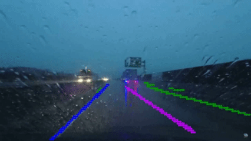

## [model_components](./model_components/)
Contains the modular PyTorch building blocks of the `EgoLanesNetwork` architecture (EfficientNet-B0 backbone, multi-scale feature fusion, AutoSteer context attention block, EgoPath decoder neck, and 3-class EgoLanes segmentation head).

## [inference](./inference/)
Helper classes for running PyTorch and ONNX inference with trained EgoLanes checkpoints.

## [visualizations](./visualizations/)
Scripts to run inference using trained models and generate single/batch image and video visualizations.

## [training](./training/)
Training pipeline (`train_ego_lanes.py` and `ego_lanes_trainer.py`) configured for multi-dataset lane boundary semantic segmentation with BCE + multi-scale edge preservation loss and TensorBoard logging.

## [data_parsing](./data_parsing/)
Dataset preprocessing scripts for converting open-source lane datasets (TuSimple, CurveLanes, OpenLane, Jiqing, ONCE3DLane, CULane, BDD100K, Comma2k19, ROADWork) into EgoLanes training format (`image/`, `mask/`, `visualization/`, `drivable_path.json`).

## [data_utils](./data_utils/)
Dataset loaders, sanity-check utilities, and albumentations-based data augmentations for EgoLanes training and evaluation.

## [exports](./exports/)
Utilities to convert trained PyTorch `.pth` checkpoints to FP32 `.onnx` format and benchmark PyTorch vs. ONNX Runtime models.

