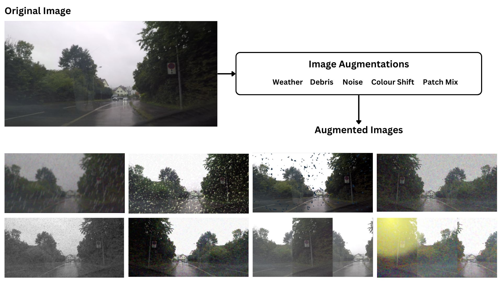

## augmentations.py
Image augmentation is an essential part of training visual neural networks. It helps harden the network to various noise effects during training and helps reduce data overfitting. The [albumentations library](https://albumentations.ai/) is used to apply resizing to `640x320` and moderate noise/weather/lighting augmentations for `SEGMENTATION`.

## check_data.py
Helper class to perform a sanity check on dataset integrity, ensuring that input images and ground-truth masks are non-empty and match in count.

## load_data_ego_lanes.py
Helper class (`LoadDataEgoLanes`) for loading processed EgoLanes datasets (`image/`, `mask/`, `drivable_path.json`), splitting them into train/validation subsets, and reading 3-channel lane segmentation masks (`ego-left`, `ego-right`, `other lanes`).

