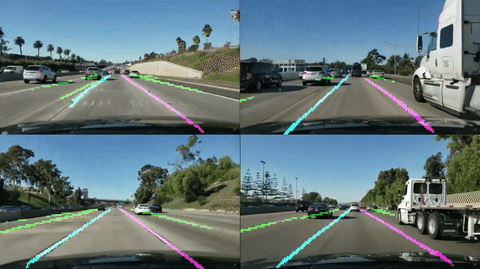
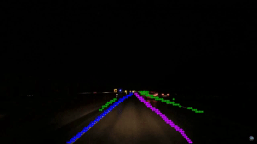

# EgoLanes - Semantic Ego-Lane Boundary Segmentation



EgoLanes is a legacy semantic end-to-end lane boundary segmentation network originally developed for the VisionPilot project (VisionPilot 0.9). It processes raw monocular camera frames and performs real-time semantic segmentation of driving lanes without relying on HD maps.

EgoLanes follows an **Encoder-Context-Decoder** architecture (`EfficientNet-B0` Backbone → Multi-scale Feature Fusion → Context MLP with Residual Attention → Decoder Neck with Skip Connections → 3-channel Segmentation Head) and outputs lane predictions at 1/4 of the input resolution (`160px × 80px` for a `640px × 320px` input image), enabling fast inference on embedded hardware.

The EgoLanes model detects and classifies lane boundaries into three channels:

- **Channel 0:** Ego-left lane boundary
- **Channel 1:** Ego-right lane boundary
- **Channel 2:** All other lane boundaries

### Training & Loss Function

EgoLanes was trained across multiple real-world driving datasets including [TuSimple](https://www.kaggle.com/datasets/manideep1108/tusimple), [OpenLane](https://github.com/OpenDriveLab/OpenLane), [CurveLanes](https://github.com/SoulmateB/CurveLanes), Jiqing, and ONCE3D Lane, using:

- **Lane-level binary cross-entropy loss (`BCEWithLogitsLoss`):** Penalizes per-channel lane segmentation errors (with higher weighting on ego-left and ego-right boundaries).
- **Multi-scale edge preservation loss:** Computes spatial gradient differences across multiple downsampled scales to preserve sharp lane boundary geometry.

### Performance Results

Validation performance at **640×320** input resolution (1/4 output stride):

| Dataset | Metric | Score |
| :--- | :--- | :---: |
| CurveLanes | mIoU | 46.9 |
| TuSimple | mIoU | 43.6 |

Embedded inference performance on **Jetson Orin Nano (8GB)** (119 GOPs; H2D + Inference + D2H):

| Backend | Forward [ms] | FPS |
| :--- | :---: | :---: |
| FP32 ONNX | 94.9 | 10.5 |
| FP32 TensorRT | 48.8 | 20.5 |

## Model Weights

**EgoLanes model weights - 2:1 aspect ratio, 320px by 640px input image**
- [Link to Download PyTorch Model Weights (*.pth)](https://drive.google.com/file/d/1Njo9EEc2tdU1ffo8AUQ9mjwuQ9CzSRPX/view?usp=sharing)
- [Link to Download ONNX FP32 Weights (*.onnx)](https://drive.google.com/file/d/1b4jAoH6363ggTgVU0b6URbFfcOL3-r1Q/view?usp=sharing)

## Get Started

To easily try out the model on your own images and videos, please follow the steps in the [tutorial](tutorial.ipynb). For the best results, please ensure that your input video matches the 2:1 aspect ratio of the model.

### Quick Inference Example

```python
from PIL import Image
from Models.inference.ego_lanes_infer import EgoLanesNetworkInfer

model = EgoLanesNetworkInfer("/path/to/egolanes.pth")  # Uses CUDA if available
img = Image.open("Media/highway_normal_1.png").convert("RGB")

# Returns (3, 80, 160) logits: [ego-left, ego-right, other lanes]
lanes_pred = model.inference(img)
```

### Tutorial

The tutorial walks you through how to download model weights, run inference on test images and videos, prepare multi-dataset training data, train the model from scratch or fine-tune from a checkpoint, and export to ONNX.



#### Test resources

Example images and a test video are provided in the `Media` directory, which you can use to try out EgoLanes (they are also used in [tutorial.ipynb](tutorial.ipynb) by default).

**Note:**

- All of our networks are trained with a single monocular camera, and only require single-camera images to run.
- For best results, please ensure that your camera image is 2:1 aspect ratio, and that the ego car hood/bonnet is not visible in the camera image provided to the network.
- Please also ensure that your camera is mounted similar to typical dash-cam setups. In particular:
  - Facing forward.
  - Center-aligned to the vehicle.
  - Approximately mounted near the top of the windscreen.

#### Compatibility

Tested with Python 3.10.12.

(Additional Python distributions will likely also be compatible)
